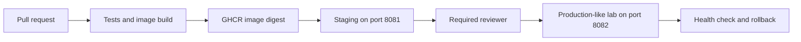

# 01. Production Delivery Platform

You join the delivery team of a small online retailer. Checkout releases are copied onto a server by hand. A failed release leaves customers unable to place an order, and nobody can say which exact image staging tested. Your task is to make release identity, approval and recovery visible.

[← All projects](../README.md) · **[Start chapter 00](00-business-scenario-and-architecture.md)**

## What you will build

A tested Orders API is published to GHCR, deployed to staging, promoted by digest through approval, and recovered safely after an unhealthy candidate.

## Before starting

Use an Ubuntu 24.04 workstation with 4 CPUs, 8 GB RAM and 20 GB free disk, plus a dedicated disposable Ubuntu Docker VM for the self-hosted deployment runner. A writable public GitHub repository enables the documented required-reviewer gate on GitHub Free. GHCR must hold a public lab image, or you must configure registry authentication on the deployment VM. This lab binds application ports to loopback; access a remote VM through SSH forwarding. VM and registry usage may incur charges.

This is an independent project: its required code and configuration live here. Use the supplied files alongside the explanations. The app and environments are portfolio labs; the guides identify which controls need strengthening before handling real customer data.

## Chapter order

| Chapter | Outcome |
| --- | --- |
| [00. Business Scenario and Architecture](00-business-scenario-and-architecture.md) | Identify the application, release script and three workflow files |
| [01. Prepare the Workstation and Repository](01-prepare-the-workstation-and-repository.md) | After installation, log out of the Ubuntu session and reconnect so the group change applies |
| [02. Run and Test the Application Locally](02-run-and-test-the-application-locally.md) | In a second terminal request curl -fsS localhost:8080/health, then curl -fsS -H "Content-Type: application/json" -d '{"item":"book"}' localhost:8080/checkout |
| [03. Build and Inspect the Container Image](03-build-and-inspect-the-container-image.md) | The process has UID 10001, health reports v1 and the image ID is recorded |
| [04. Create Pull Request Checks](04-create-pull-request-checks.md) | Open a branch and pull request in your repository |
| [05. Publish and Identify an Immutable Release](05-publish-and-identify-an-immutable-release.md) | Run Publish Orders release from Actions |
| [06. Deploy and Verify Staging](06-deploy-and-verify-staging.md) | Staging health and checkout pass |
| [07. Promote the Same Release With Approval](07-promote-the-same-release-with-approval.md) | Run Promote Orders release using the exact IMAGE digest |
| [08. Introduce a Failed Release and Roll Back](08-introduce-a-failed-release-and-roll-back.md) | The unhealthy candidate exits nonzero and production remains healthy |
| [09. Capture Evidence and Remove Lab Resources](09-capture-evidence-and-remove-lab-resources.md) | No project containers or networks remain |

## Implementation files

- `app/` — Orders API, Dockerfile and behavioral test.
- `deploy/` — Health-gated switching and cleanup scripts.
- `workflows/` — CI, publishing and promotion files installed at your repository root.

## Acceptance criteria

- Pull request tests reject a broken change.
- Staging and production-like lab use the same immutable digest.
- Promotion pauses for a required reviewer.
- An unhealthy candidate cannot replace the active release.
- An earlier digest can be redeployed and verified.
- Lab containers, networks, keys and workflow access are cleaned up.

## Further reference

- [GitHub environment protection](https://docs.github.com/en/actions/how-tos/deploy/configure-and-manage-deployments/manage-environments)
- [Docker build concepts](https://docs.docker.com/build/concepts/overview/)
