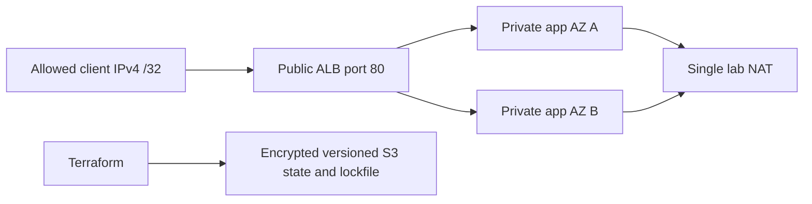

# 02. Secure Cloud Infrastructure Platform

The retailer’s infrastructure is managed from individual laptops with local Terraform state. A private service was exposed accidentally, and changes made through the console are difficult to reconcile. You are responsible for a repeatable network and compute foundation with controlled access and collaborative state.

[← All projects](../README.md) · **[Start chapter 00](00-business-requirements-and-network-design.md)**

## What you will build

A scoped AWS VPC with public load balancer, private application instances, native S3 state locking, separate environment keys and a tested cleanup procedure.

## Before starting

An AWS lab account with a budget alert and permissions for VPC, EC2, Auto Scaling, ELB, IAM instance roles, S3 and SSM parameter reads. Use temporary AWS credentials and MFA. Two small instances, an ALB, a NAT gateway, EBS and public IPv4 allocations cost money. This deliberately uses one NAT gateway to bound lab cost; it is a cross-AZ dependency and not a highly available egress design. The HTTP listener is restricted to your IPv4 /32 and serves dummy content only; real customer traffic requires TLS.

This is an independent project: its required code and configuration live here. Use the supplied files alongside the explanations. The app and environments are portfolio labs; the guides identify which controls need strengthening before handling real customer data.

## Chapter order

| Chapter | Outcome |
| --- | --- |
| [00. Business Requirements and Network Design](00-business-requirements-and-network-design.md) | Draw internet → ALB → private instance and private instance → NAT → package repositories |
| [01. Prepare AWS Access Budget and Tooling](01-prepare-aws-access-budget-and-tooling.md) | The caller ARN and account are the intended lab identity |
| [02. Inspect the Resources Before Automating](02-inspect-the-resources-before-automating.md) | Record the existing inventory and read every planned resource type |
| [03. Bootstrap Protected Remote State](03-bootstrap-protected-remote-state.md) | The S3 bucket shows versioning Enabled, default encryption and all public-access blocks enabled |
| [04. Build the VPC Subnets and Routes](04-build-the-vpc-subnets-and-routes.md) | The plan shows exactly one VPC, two public subnets, two private subnets and one NAT gateway |
| [05. Configure Access and Security Boundaries](05-configure-access-and-security-boundaries.md) | Review the source restriction, app group reference, IMDSv2 requirement and encrypted root volumes |
| [06. Provision the Application Compute Layer](06-provision-the-application-compute-layer.md) | The page contains Orders foundation and dev |
| [07. Separate Environments and Review Changes](07-separate-environments-and-review-changes.md) | Dev plan says No changes |
| [08. Demonstrate Drift Locking and Recovery](08-demonstrate-drift-locking-and-recovery.md) | The plan proposes restoring the Name tag to orders-dev |
| [09. Verify the Architecture Record Costs and Destroy](09-verify-the-architecture-record-costs-and-destroy.md) | The workload state contains no managed resources after destroy |

## Implementation files

- `bootstrap/` — Implementation used by the numbered chapters.
- `scripts/` — Implementation used by the numbered chapters.
- `terraform/` — Implementation used by the numbered chapters.

## Acceptance criteria

- No application instance has a public IPv4 or inbound SSH rule.
- The ALB accepts only the chosen client /32 and reaches both private targets.
- State is encrypted, versioned, private and locked through S3 use_lockfile.
- Dev/prod use different backend keys and CIDRs.
- Drift is detected and an instance replacement is observed.
- Workload resources are destroyed before state storage is considered for deletion.

## Further reference

- [Terraform S3 backend and native locking](https://developer.hashicorp.com/terraform/language/backend/s3)
- [AWS VPC routing](https://docs.aws.amazon.com/vpc/latest/userguide/VPC_Route_Tables.html)
