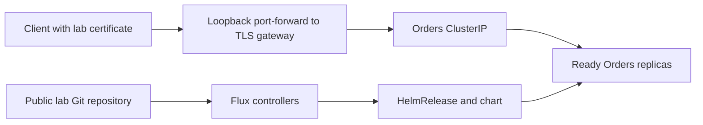

# 03. Kubernetes Application Platform

Application teams need a repeatable release path without hand-editing running pods. You are building a small platform that exposes an HTTPS endpoint, packages the service, controls runtime configuration and reconciles releases from Git.

[← All projects](../README.md) · **[Start chapter 00](00-platform-requirements-and-request-flow.md)**

## What you will build

An Orders Helm release runs in a local multi-node kind cluster, serves trusted lab HTTPS, and is reconciled from Git with a demonstrated failed rollout and recovery.

## Before starting

Ubuntu 24.04 with Docker, 4 CPUs and at least 8 GB available RAM; GitHub repository you can write; Git, Python, curl and OpenSSL. kind nodes are containers on one host, so they are not independent physical failure domains. HTTPS uses a generated lab certificate explicitly supplied to curl, not a public certificate or modified system trust store. No cloud load balancer or EKS resource is created.

This is an independent project: its required code and configuration live here. Use the supplied files alongside the explanations. The app and environments are portfolio labs; the guides identify which controls need strengthening before handling real customer data.

## Chapter order

| Chapter | Outcome |
| --- | --- |
| [00. Platform Requirements and Request Flow](00-platform-requirements-and-request-flow.md) | Explain the browser → TLS gateway → Service → pod path and the independent Git → Flux → Helm control path |
| [01. Install Tools and Create the Lab Cluster](01-install-tools-and-create-the-lab-cluster.md) | The context is kind-orders-platform and three nodes become Ready |
| [02. Build and Load the Application Image](02-build-and-load-the-application-image.md) | Application tests pass, the image load succeeds and the orders-runtime Secret exists in orders |
| [03. Deploy the Workload and Understand Each Manifest](03-deploy-the-workload-and-understand-each-manifest.md) | In a second terminal, curl localhost:8080/health and POST a valid checkout |
| [04. Configure Services Routing and HTTPS](04-configure-services-routing-and-https.md) | In a second terminal from this project directory run curl --cacert .lab/tls.crt --resolve orders.local:8443:127.0.0.1 https://orders.local:8443/health |
| [05. Package the Application With Helm](05-package-the-application-with-helm.md) | Helm records the original release, an upgrade and a rollback revision |
| [06. Add Configuration Secrets and Resource Controls](06-add-configuration-secrets-and-resource-controls.md) | Resource requests reflect the chosen values and the application still passes checkout |
| [07. Reconcile Releases Through GitOps](07-reconcile-releases-through-gitops.md) | Flux source, Kustomization and HelmRelease report Ready |
| [08. Diagnose a Failed Rollout and Demonstrate Recovery](08-diagnose-a-failed-rollout-and-demonstrate-recovery.md) | Record the failing revision and ImagePullBackOff events |
| [09. Collect Platform Evidence and Delete the Cluster](09-collect-platform-evidence-and-delete-the-cluster.md) | orders-platform no longer appears in kind get clusters, and its Docker node containers are gone |

## Implementation files

- `app/` — Implementation used by the numbered chapters.
- `chart/` — Implementation used by the numbered chapters.
- `gitops/` — Implementation used by the numbered chapters.
- `platform/` — Implementation used by the numbered chapters.

## Acceptance criteria

- Two ready application replicas are reached through a stable service.
- HTTPS verifies with the supplied lab certificate and correct hostname.
- Secrets stay outside Git and the pod runs as a non-root user.
- Flux observes a Git commit and corrects drift.
- An invalid image is diagnosed and corrected through Git.
- The disposable cluster and certificate/key are removed.

## Further reference

- [kind quick start](https://kind.sigs.k8s.io/docs/user/quick-start/)
- [Flux HelmRelease](https://fluxcd.io/flux/components/helm/helmreleases/)
- [Kubernetes probes](https://kubernetes.io/docs/tasks/configure-pod-container/configure-liveness-readiness-startup-probes/)
