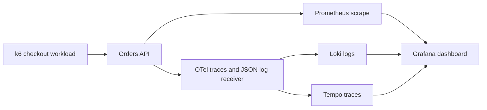

# 04. SRE Observability and Incident Response

Customers report checkout failures, but the team’s only dashboard shows that the process is running. You must build observability around the customer action, connect failures to logs and traces, and rehearse a measured response.

[← All projects](../README.md) · **[Start chapter 00](00-customer-journey-reliability-goal-and-architecture.md)**

## What you will build

Checkout metrics, JSON logs and OpenTelemetry traces reach local backends; a customer-error alert fires during an injected fault and resolves after recovery.

## Before starting

Docker with Compose v2 on Ubuntu 24.04, 4 CPUs and 8 GB RAM; curl, Python and k6. All published interfaces bind to loopback. The local stack uses single-process ephemeral storage and no backend authentication, so it must not be exposed publicly. One log-writing container runs as root for named-volume convenience; that lab shortcut is explicitly not a production security baseline.

This is an independent project: its required code and configuration live here. Use the supplied files alongside the explanations. The app and environments are portfolio labs; the guides identify which controls need strengthening before handling real customer data.

## Chapter order

| Chapter | Outcome |
| --- | --- |
| [00. Customer Journey Reliability Goal and Architecture](00-customer-journey-reliability-goal-and-architecture.md) | Write the SLI numerator, denominator, latency threshold and observation window before generating traffic |
| [01. Start the Application and Establish Normal Behavior](01-start-the-application-and-establish-normal-behavior.md) | Health is ok, checkout returns 201, and docker compose ps shows the stack running |
| [02. Instrument Request Metrics](02-instrument-request-metrics.md) | The 201 counter increases by twenty and the histogram count increases accordingly |
| [03. Add Structured Logs and Trace Context](03-add-structured-logs-and-trace-context.md) | The event is valid JSON and has a nonempty 32-character trace_id when telemetry is configured |
| [04. Connect Metrics Logs and Traces to the Backends](04-connect-metrics-logs-and-traces-to-the-backends.md) | In Grafana Explore select Loki and query {service_name="orders"} |
| [05. Build and Explain the Dashboard](05-build-and-explain-the-dashboard.md) | Open Dashboards → Orders customer journey in Grafana |
| [06. Define an SLO and an Actionable Alert](06-define-an-slo-and-an-actionable-alert.md) | Both promtool checks pass |
| [07. Generate Load and Introduce a Controlled Failure](07-generate-load-and-introduce-a-controlled-failure.md) | Record baseline p95 and error rate |
| [08. Investigate Recover and Write the Incident Timeline](08-investigate-recover-and-write-the-incident-timeline.md) | Checkout returns 201 again, recovered load meets the lab thresholds and the alert returns inactive after the trailing window |
| [09. Measure Results Export Evidence and Clean Up](09-measure-results-export-evidence-and-clean-up.md) | All stack containers stop and the project log volume is removed |

## Implementation files

- `app/` — Implementation used by the numbered chapters.
- `monitoring/` — Implementation used by the numbered chapters.

## Acceptance criteria

- A checkout request appears in metrics, logs and a trace.
- Grafana panels reflect request rate, failures and latency.
- The error ratio alert fires while failed checkouts continue.
- Recovery is verified with business requests and alert resolution.
- Detection and recovery timestamps are measured.
- The stack and local log data are deleted.

## Further reference

- [OpenTelemetry Collector configuration](https://opentelemetry.io/docs/collector/configuration/)
- [Prometheus alerting rules](https://prometheus.io/docs/prometheus/latest/configuration/alerting_rules/)
- [k6 results](https://grafana.com/docs/k6/latest/results-output/end-of-test/)
