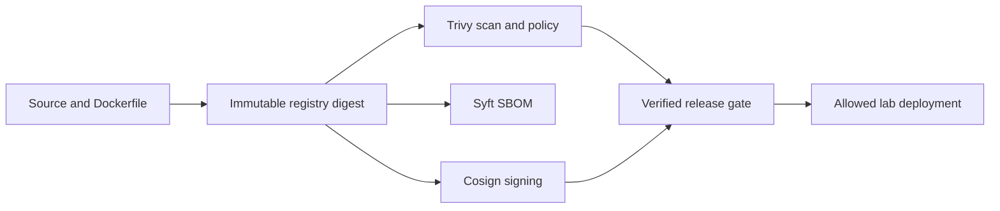

# 05. Software Supply Chain Security

A team can deploy any image tag, including one it has never scanned or verified. You must establish an explicit release policy, attach evidence to the artifact and make the deployment entry point reject a release that does not meet that policy.

[← All projects](../README.md) · **[Start chapter 00](00-threat-model-and-release-policy.md)**

## What you will build

A scan-and-sign workflow produces an SBOM and proves both successful verification and rejection; a release wrapper enforces signature and vulnerability checks before deployment.

## Before starting

Docker, Ubuntu 24.04, Python and a public lab GHCR package you can publish. Signing keys must remain outside Git. Cosign can record signatures and artifact hashes in a public transparency log; use only public dummy artifacts. The core enforcement is a deployment script and CI policy, not a Kubernetes admission controller or a cryptographic binding of a scan result to a signed attestation.

This is an independent project: its required code and configuration live here. Use the supplied files alongside the explanations. The app and environments are portfolio labs; the guides identify which controls need strengthening before handling real customer data.

## Chapter order

| Chapter | Outcome |
| --- | --- |
| [00. Threat Model and Release Policy](00-threat-model-and-release-policy.md) | Write the policy in plain language, identify the trusted public key and explain why tags alone cannot identify an approved release. |
| [01. Prepare the Repository Tools and Registry](01-prepare-the-repository-tools-and-registry.md) | All tools report versions, Docker is functional and authentication succeeds |
| [02. Establish a Reproducible Baseline Build](02-establish-a-reproducible-baseline-build.md) | Tests pass and IMAGE has the expected registry path plus @sha256: followed by 64 hex characters |
| [03. Scan Dependencies and Container Contents](03-scan-dependencies-and-container-contents.md) | A real scan file contains Results and scanner metadata |
| [04. Produce and Inspect the SBOM](04-produce-and-inspect-the-sbom.md) | The SBOM parses, lists components and verifies against the generated public key |
| [05. Sign and Verify the Release Artifact](05-sign-and-verify-the-release-artifact.md) | The signature payload identifies the same image digest as .lab/image.txt |
| [06. Enforce the Checks in CI](06-enforce-the-checks-in-ci.md) | Open a pull request and inspect the policy test, scan and evaluation steps |
| [07. Enforce the Deployment Verification Policy](07-enforce-the-deployment-verification-policy.md) | The wrapper passes for the trusted signed digest only when its current scan meets policy |
| [08. Prove Rejection Remediation and Exception Handling](08-prove-rejection-remediation-and-exception-handling.md) | Capture the failed tamper verification and passing positive/negative policy tests |
| [09. Publish Sanitized Evidence and Revoke Lab Access](09-publish-sanitized-evidence-and-revoke-lab-access.md) | No lab container remains |

## Implementation files

- `app/` — Implementation used by the numbered chapters.
- `policy/` — Implementation used by the numbered chapters.
- `scripts/` — Implementation used by the numbered chapters.
- `workflows/` — Implementation used by the numbered chapters.

## Acceptance criteria

- The image is identified by a digest and its SBOM is inspectable.
- A fixed HIGH/CRITICAL vulnerability causes a policy failure.
- The expected key verifies the image; an unrelated key does not.
- A changed SBOM fails blob signature verification.
- CI records the scan result even on policy failure.
- The deployment wrapper returns success only when signature and current scan policy pass.

## Further reference

- [Sigstore signing and verification](https://docs.sigstore.dev/cosign/signing/overview/)
- [Trivy image scanning](https://trivy.dev/latest/docs/target/container_image/)
- [Syft](https://github.com/anchore/syft)
