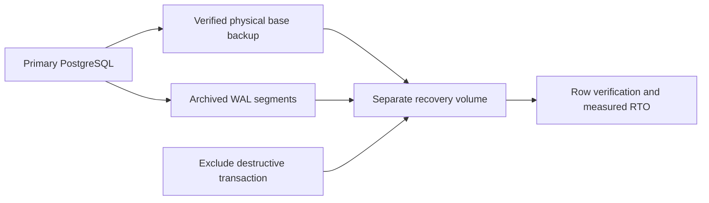

# 06. Database Reliability and Disaster Recovery

A mistaken SQL change deletes customer orders. The database process stays healthy, so a restart does not restore the missing records. You must combine a physical base backup with archived write-ahead logs and prove recovery to just before the destructive transaction.

[← All projects](../README.md) · **[Start chapter 00](00-data-loss-scenario-and-recovery-objectives.md)**

## What you will build

A PostgreSQL 17 database produces verified physical backups and archived WAL; a separate recovery instance restores both original orders before a known delete transaction.

## Before starting

Ubuntu 24.04, Docker Compose v2, Bash and OpenSSL. The lab uses only dummy records and named local volumes; it creates no public database port. Keep the Compose project name portfolio-recovery unchanged because the restore helper names its backup volume. Local volumes are not off-host disaster protection. Disk encryption, off-site retention and production backup key custody are additional requirements beyond this local recovery exercise.

This is an independent project: its required code and configuration live here. Use the supplied files alongside the explanations. The app and environments are portfolio labs; the guides identify which controls need strengthening before handling real customer data.

## Chapter order

| Chapter | Outcome |
| --- | --- |
| [00. Data Loss Scenario and Recovery Objectives](00-data-loss-scenario-and-recovery-objectives.md) | Write the expected original data: orders 1/book and 2/keyboard |
| [01. Start PostgreSQL and Create Known Test Data](01-start-postgresql-and-create-known-test-data.md) | The database becomes healthy and shows exactly the two known rows |
| [02. Configure the Backup Repository and Credentials](02-configure-the-backup-repository-and-credentials.md) | The live data, backup and archive volumes have distinct names |
| [03. Create and Verify the First Backup](03-create-and-verify-the-first-backup.md) | The backup helper exits zero and pg_verifybackup reports success |
| [04. Enable and Inspect WAL Archiving](04-enable-and-inspect-wal-archiving.md) | archive_mode is on and archived_count increases |
| [05. Schedule Backups and Detect Backup Failures](05-schedule-backups-and-detect-backup-failures.md) | The stopped-database attempt fails and does not move /backup/latest |
| [06. Introduce a Controlled Data Loss Event](06-introduce-a-controlled-data-loss-event.md) | The source count is zero, .lab/delete-xid contains only a numeric transaction ID and the selected WAL segment is present in /archive |
| [07. Restore to the Selected Recovery Point](07-restore-to-the-selected-recovery-point.md) | Both rows reappear and pg_is_in_recovery is false |
| [08. Verify Data and Measure Recovery Objectives](08-verify-data-and-measure-recovery-objectives.md) | Restored rows are 1&#124;book and 2&#124;keyboard; recovery is false; the source still has zero rows |
| [09. Write the Recovery Runbook and Remove Lab Data](09-write-the-recovery-runbook-and-remove-lab-data.md) | The primary, archive, backup and restored volumes are removed after evidence is saved |

## Implementation files

- `database/` — Implementation used by the numbered chapters.
- `scripts/` — Implementation used by the numbered chapters.

## Acceptance criteria

- A verified pg_basebackup completes before data loss.
- archive_mode is on and the required post-delete WAL segment is archived.
- The destructive transaction ID is recorded precisely.
- A separate volume recovers with recovery_target_inclusive=false.
- Both original rows return and recovery has promoted.
- RTO and RPO are measured, backups are checked, and all lab data is removed.

## Further reference

- [PostgreSQL continuous archiving and PITR](https://www.postgresql.org/docs/17/continuous-archiving.html)
- [pg_basebackup](https://www.postgresql.org/docs/17/app-pgbasebackup.html)
- [pg_verifybackup](https://www.postgresql.org/docs/17/app-pgverifybackup.html)
