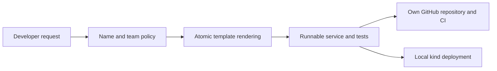

# 07. Developer Self-Service Platform

Every new team service needs the same repository skeleton, health endpoint, tests, Dockerfile, CI workflow and deployment configuration. Manual setup is slow and inconsistent. You must provide a validated developer request that produces a complete runnable service without leaving half-generated output after failure.

[← All projects](../README.md) · **[Start chapter 00](00-developer-request-and-platform-contract.md)**

## What you will build

A CLI portal creates a complete named service atomically, validates team/name inputs, runs generated tests, publishes to the learner’s repository and deploys to a local cluster.

## Before starting

Ubuntu 24.04, Python 3.9+, Git and curl for the generator. Docker, kind and kubectl are needed for the deployment chapter; a writable GitHub account and GitHub CLI are needed for repository integration. The CLI is a local developer interface, not an authenticated multi-tenant web portal. Team policy validates allowed ownership values; filesystem and GitHub access still come from the user running it.

This is an independent project: its required code and configuration live here. Use the supplied files alongside the explanations. The app and environments are portfolio labs; the guides identify which controls need strengthening before handling real customer data.

## Chapter order

| Chapter | Outcome |
| --- | --- |
| [00. Developer Request and Platform Contract](00-developer-request-and-platform-contract.md) | List the request inputs and generated outputs |
| [01. Run the Platform Locally](01-run-the-platform-locally.md) | All four generator tests pass |
| [02. Define the Service Template and Inputs](02-define-the-service-template-and-inputs.md) | Invalid names are rejected before rendering |
| [03. Generate and Test the First Service](03-generate-and-test-the-first-service.md) | In another terminal curl localhost:8080/health and expect service orders-api and team payments |
| [04. Add the Delivery Workflow and Repository Integration](04-add-the-delivery-workflow-and-repository-integration.md) | The new repository contains only the generated service, and its Check generated service workflow runs tests and builds the image |
| [05. Produce the Service Deployment Configuration](05-produce-the-service-deployment-configuration.md) | In a second terminal request localhost:8080/health and expect orders-api/payments |
| [06. Enforce Naming Input and Access Rules](06-enforce-naming-input-and-access-rules.md) | Each invalid request exits nonzero and the valid existing service remains runnable |
| [07. Run a Complete Developer Onboarding Journey](07-run-a-complete-developer-onboarding-journey.md) | A second terminal request to localhost:8083/health identifies inventory-api/platform |
| [08. Test Failed Requests Retry and Rollback](08-test-failed-requests-retry-and-rollback.md) | The failed request leaves no recovery-api directory or staging leftovers; retry creates a complete service and its HTTP test passes. |
| [09. Measure Onboarding Results and Clean Up](09-measure-onboarding-results-and-clean-up.md) | The lab cluster and generated local copies are removed after evidence is saved |

## Implementation files

- `automation/` — Implementation used by the numbered chapters.
- `portal/` — Implementation used by the numbered chapters.
- `template/` — Implementation used by the numbered chapters.

## Acceptance criteria

- A valid request produces working application, tests, image and deployment files.
- Invalid names and unknown teams are rejected.
- Duplicate requests cannot overwrite an existing service.
- A simulated rendering failure leaves no partial service.
- The generated repository runs its own CI.
- The generated service becomes ready and responds in a local cluster.

## Further reference

- [GitHub CLI repository creation](https://cli.github.com/manual/gh_repo_create)
- [Python temporary directories](https://docs.python.org/3/library/tempfile.html)
- [Kubernetes Deployments](https://kubernetes.io/docs/concepts/workloads/controllers/deployment/)
