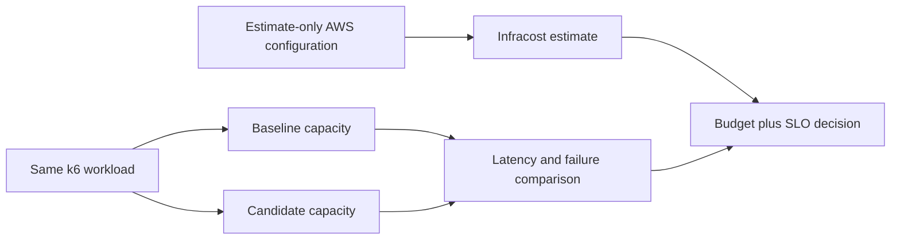

# 08. Cloud Cost and Capacity Optimization

The retailer wants a lower infrastructure bill but cannot accept failed or slow checkouts. You must compare workload behavior before and after a capacity change, estimate a supported cloud configuration and make a documented accept/reject decision.

[← All projects](../README.md) · **[Start chapter 00](00-business-budget-and-performance-target.md)**

## What you will build

Repeatable load results and estimate-only Terraform inputs support a cost/performance decision, with a budget check that rejects missing or excessive estimates.

## Before starting

Ubuntu 24.04, Docker Compose v2, Python, Terraform and an Infracost account/API key. The core workload is local and Terraform is an estimate fixture with an intentionally blocked apply; no cloud instance is provisioned. The application capacity experiment and AWS estimate are related design evidence, not an exact equivalence between a fractional Docker CPU and an EC2 instance type. Estimates are time/region/usage-dependent.

This is an independent project: its required code and configuration live here. Use the supplied files alongside the explanations. The app and environments are portfolio labs; the guides identify which controls need strengthening before handling real customer data.

## Chapter order

| Chapter | Outcome |
| --- | --- |
| [00. Business Budget and Performance Target](00-business-budget-and-performance-target.md) | Write down the workload duration, virtual users, success/latency thresholds, estimate region and budget |
| [01. Prepare the Workload and Cost Assumptions](01-prepare-the-workload-and-cost-assumptions.md) | Application and comparison tests pass, the service is healthy and the rendered Compose limits are recorded |
| [02. Measure the Baseline Under Repeatable Load](02-measure-the-baseline-under-repeatable-load.md) | The baseline summary exists, contains http_req_duration and http_req_failed, and the run meets the fixed thresholds before optimization |
| [03. Estimate the Infrastructure Configuration](03-estimate-the-infrastructure-configuration.md) | Both JSON estimates have a non-null totalMonthlyCost |
| [04. Attribute Resource Consumption](04-attribute-resource-consumption.md) | Record CPU and memory for the app, the request count and the observation time |
| [05. Change Capacity and Resource Requests](05-change-capacity-and-resource-requests.md) | The candidate summary was collected using the same load-test.js and duration as baseline |
| [06. Re-run the Same Workload and Cost Comparison](06-re-run-the-same-workload-and-cost-comparison.md) | The comparison contains both p95 values, failure ratios, request counts and candidate_passes_slo |
| [07. Add Budget and Change Review Checks](07-add-budget-and-change-review-checks.md) | The realistic budget check produces a visible decision; the deliberately tiny budget fails |
| [08. Evaluate Performance Cost and Reliability Tradeoffs](08-evaluate-performance-cost-and-reliability-tradeoffs.md) | The baseline capacity is restored and healthy |
| [09. Produce the Optimization Report and Remove Resources](09-produce-the-optimization-report-and-remove-resources.md) | No local app container remains |

## Implementation files

- `app/` — Implementation used by the numbered chapters.
- `scripts/` — Implementation used by the numbered chapters.
- `terraform/` — Implementation used by the numbered chapters.

## Acceptance criteria

- Baseline and candidate use the same request pattern and duration.
- Measured p95 and failure ratio are compared against fixed lab thresholds.
- Both cloud estimates preserve their assumptions and generation date.
- Missing estimates fail closed rather than count as zero cost.
- A failing SLO or budget blocks the optimization decision.
- No estimate-only Terraform resources are applied.

## Further reference

- [Infracost getting started](https://www.infracost.io/docs/)
- [k6 end-of-test results](https://grafana.com/docs/k6/latest/results-output/end-of-test/)
- [Docker resource constraints](https://docs.docker.com/engine/containers/resource_constraints/)
